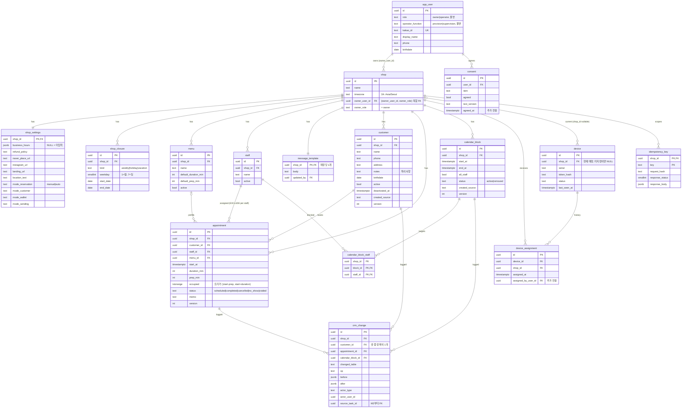
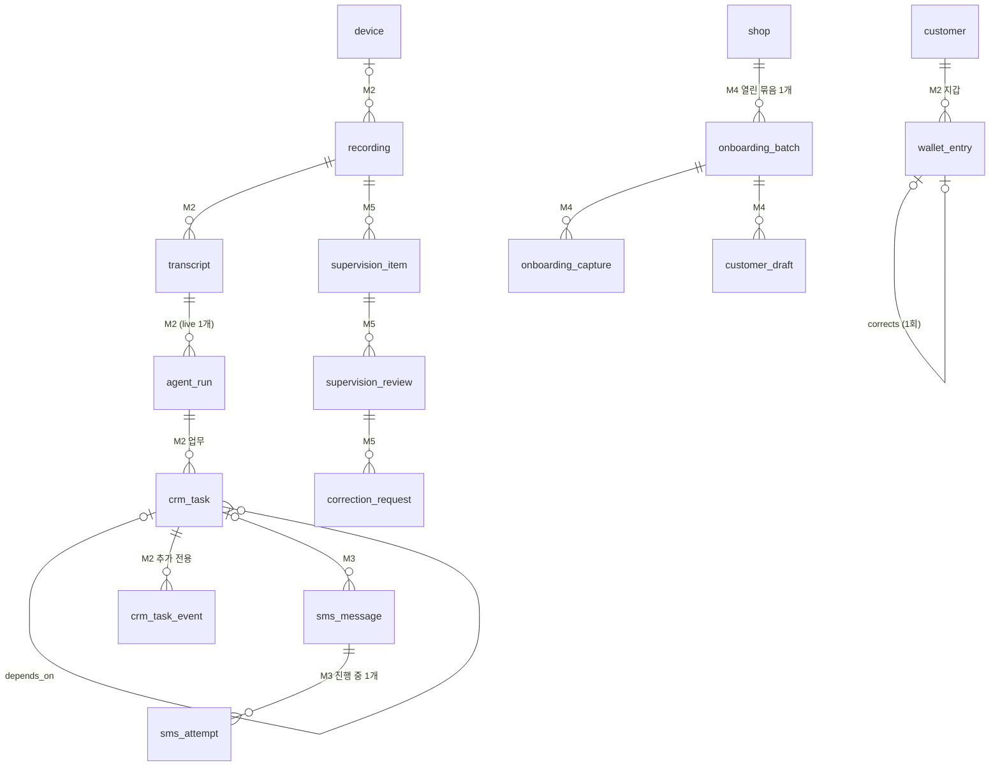

# 01. Phase 2 ERD 설계 (개발팀안)

> 상태: 🟡 **제안** — 2F(BEA-155 스키마) 담당 리뷰 후 확정. 확정되면 마이그레이션은 이 문서를 따른다.
> 기준: Linear「[P2] 명세 1·2」(11/19 최종판). 명세 2는 **불변식·권한은 지켜야 하고, 열 타입·이름·트리거 구성·SQL 초안은 개발팀에 위임**했다(명세 2 "문서의 지위"). 이 문서는 그 위임 범위에서 구조를 최적화한 개발팀안이다. 명세 본문은 옮기지 않고 불변식 번호(①~⑳)와 기능 번호로 가리킨다.
> 확인: 명세 2의 SQL 초안은 PostgreSQL 18(docker)에서 오류 없이 적용되고 핵심 불변식(담당자 겹침·생성 상태·변경 이력·행위자 필수)이 동작함을 11/19 확인했다. 아래 최적화는 그 초안을 출발점으로 한다.

## 0. 원칙

1. **흐름과 불변식은 명세 그대로.** 명세 2 §3.1의 불변식 ①~⑳(㉑ MCP는 연기)과 §3.2 추가 제약을 모두 지킨다. 강제 지점(DB/앱)도 명세가 DB로 둔 것은 DB로 둔다.
2. **구조는 우리가 최적화.** 같은 불변식을 더 적은 객체·더 단순한 구성으로 지키는 쪽을 고른다.
3. **마일스톤만큼만 깐다.** 전체 24개 테이블을 한 번에 만들지 않고, 그 마일스톤의 기능이 쓰는 테이블·역할만 마이그레이션으로 추가한다.
4. **앱 버그·AI 실수가 데이터 사고가 되는 지점은 작아도 DB에 둔다** — 매장 격리, 같은 담당자 겹침, 돈 기록 불변, 변경 이력.

## 1. 최적화 결정 (명세 초안 → 개발팀안)

| # | 명세 초안 | 개발팀안 | 이유 | 지키는 불변식 |
|---|---|---|---|---|
| D1 | `public` 스키마 | **`crm` 스키마 하나** | 지금 저장소(001~006)와 같은 스키마, 확장(`btree_gist`) 함수와 섞이지 않음 | — |
| D2 | `shop.shop_id = id` 자기 참조 열(Phase 1 루트 규약) | **`shop.shop_id` 제거**. 자식은 `shop(id)` 참조 | Phase 2는 별도 DB라 Phase 1 규약을 이어받을 필요 없음. 매장 소속 테이블의 `(shop_id, id)` 패턴은 그대로 | ① |
| D3 | PK는 호출자 UUID, 기본값 없음 | **`DEFAULT gen_random_uuid()`**, 호출자가 줄 수도 있음 | 멱등 재전송·온보딩 일괄 확정은 호출자 id를 쓰고, 나머지는 서버 생성으로 단순하게 | ⑮ |
| D4 | 조인 테이블에도 `id`·`created_at`·`updated_at` | `calendar_block_staff`는 **`(shop_id, block_id, staff_id)` PK만** | 행 자체를 고치지 않는 연결 테이블. 이력은 차단 대상으로 `crm_change`에 남음 | ①, ⑯ |
| D5 | (현재 저장소) `user_membership` + 카카오 열(004·005) | **`app_user` + `shop.owner_user_id`**(명세 구조)로 교체, 카카오 ID는 `app_user.kakao_id` | 원장 1명이 매장 N개(매장 전환), 매장당 원장 1명을 테이블 추가 없이 DB가 강제 | ② |
| D6 | 역할 7개를 한 번에 | **마일스톤별 도입**: M1 `bv_app`·`bv_provision`·`bv_definer` / M2 `bv_ai_executor`·`bv_system` / M5 `bv_ops` / MCP 연기 | 쓰지 않는 역할과 정책(147개 중 대부분)을 미리 만들지 않음. 역할이 들어올 때 그 역할 정책을 함께 추가 | ⑰ ⑱ ⑲ |
| D7 | 테이블·역할마다 개별 RLS 정책 | **매장 범위 정책은 공통 함수 하나**(`crm.in_shop_scope(shop_id)` — 트랜잭션 설정 `bv.shop_ids` 읽음) + 역할 차이는 `GRANT`로 | 정책 수를 줄이고, 매장 범위 판정이 한 곳에만 있게 | ① |
| D8 | 테이블별 상태 전이 함수 | **허용 전이표(`crm.status_transition`) + 공통 트리거 하나** | 예약·차단·업무·문자·온보딩·감독 전이를 같은 방식으로. 허용 쌍은 데이터라 리뷰·테스트가 쉬움 | ⑦, §3.2 "허용 쌍만" |
| D9 | 추가 전용 테이블별 거부 트리거 | **공통 거부 함수 하나**를 각 테이블에 연결(명세와 같은 방식, 이름만 통일) | — | ⑥ |
| D10 | `appointment.occupied`를 트리거가 계산 | **명세대로 트리거**(우리 #33의 "앱 계산 + CHECK"는 버림) | 손 입력·음성 업무·되돌리기 어느 경로든 같은 계산 | ③ |
| D11 | (명세 밖) | **`idempotency_key` 유지**(F-05, #28) | 모든 쓰기 API의 멱등. 문자·업무의 멱등(⑮)과 별개로 API 계층에 필요 | ⑮ |
| D12 | Phase 1 테이블을 `ALTER` | **Phase 2 DB에서 `CREATE`**. Phase 1 전용 `entry`·`task`는 만들지 않음 | 명세 결정 T1(별도 DB) | — |
| D13 | `v_appointment_conflict` 뷰 | **M1에 포함**(차단 충돌 표시용) | 차단 생성은 기존 예약을 막지 않고 충돌로 표시(BEA-179) | §3.2 차단 |

## 2. ERD

### 2-1. M1 손으로 쓰는 CRM (15 테이블 + 뷰 1)

### 2-2. M2~M5에 더하는 테이블

| 마일스톤 | 더하는 테이블 | 더하는 역할 | 이때 붙는 불변식 |
|---|---|---|---|
| M2 | `wallet_entry`, `recording`, `transcript`, `agent_run`, `crm_task`, `crm_task_event` (+ `crm_change.source_task_id` FK, `v_customer_balance`) | `bv_ai_executor`, `bv_system` | ④⑤⑥⑧⑨⑩⑪⑫⑬⑮⑰ |
| M3 | `sms_message`, `sms_attempt` | — | ⑭⑮⑳ |
| M4 | `onboarding_batch`, `onboarding_capture`, `customer_draft` | — | §3.2 온보딩 |
| M5 | `supervision_item`, `supervision_review`, `correction_request` | `bv_ops` | ⑱ |

## 3. M1에서 지키는 불변식과 강제 지점

| 불변식 | 강제 지점(개발팀안) |
|---|---|
| ① 다른 매장 참조 금지 | 매장 소속 테이블마다 `UNIQUE (shop_id, id)`, 자식은 `(shop_id, parent_id)` 복합 FK. `crm_change`는 대상 열 셋 중 정확히 1개 CHECK + 각 열 복합 FK. RLS는 공통 함수(D7) |
| ② 매장당 원장 1명·원장 N매장 | `shop (owner_user_id, owner_role) → app_user (id, role)` 복합 FK, `owner_role = 'owner'` CHECK |
| ③ 담당자별 점유 비중복·준비 시간은 앞 | `appointment.occupied` 트리거 계산 + `EXCLUDE USING gist (shop_id WITH =, staff_id WITH =, occupied WITH &&) WHERE status NOT IN ('cancelled','voided')`. 저장 전 판정·오류 안내는 앱(`booking.ts`, #36) |
| ⑥ 추가 전용(`consent`·`crm_change`·`device_assignment`) | 공통 거부 트리거(D9) + 쓰기 역할의 UPDATE/DELETE 권한 없음 |
| ⑦ 운영 메타데이터는 정한 주체·전이로만 | 열 단위 `GRANT UPDATE (…)` + 허용 전이표(D8): 예약 5상태(무효는 업무 되돌리기만, 무효에서 나가지 않음), 차단 active↔removed |
| ⑯ 변경 이력 빠짐없이 | `customer`·`appointment`·`calendar_block`·`calendar_block_staff`의 행 트리거(`SECURITY DEFINER`, `bv_definer` 소유)만 `crm_change`에 INSERT. 행위자는 트랜잭션 설정 `bv.actor_type` 등에서 읽고 없으면 실패 |
| ⑰ AI는 설정을 쓰지 않음 | M1에는 AI 역할이 없음. M2에서 `bv_ai_executor`에 설정 테이블 권한을 주지 않음 |
| ⑲ 등록은 별도 역할·계정 | `app_user.role`·`operator_function` CHECK + 생성 뒤 변경 거부 트리거. 등록 경로만 `bv_provision` |
| §3.2 차단 | 활성 차단과 겹치는 예약 생성·이동 거부 트리거(예약 쪽에서만), `all_staff`와 대상 담당자 행 일치는 지연 제약 트리거. 충돌 표시는 `v_appointment_conflict` |
| §3.2 영업시간·휴무 | 앱(예약 쓰기 함수 + `booking.ts`). 명세대로 DB 제약 아님 |
| §3.2 암묵적 삭제 없음 | 모든 FK `ON DELETE NO ACTION`. 고객은 `active`, 예약·차단은 상태로만 |
| 동시 수정(뒤의 저장 거부) | CRM 행 `version` + 쓰기 함수의 `WHERE version = $expected` (BEA-160) |

## 4. 마이그레이션 계획

**지금 main(001~006)과의 관계:** 파일럿 전이라 운영 데이터가 없다. 새 구조는 001~006과 겹치는 부분(`shop`, `user_membership`, `appointment`)이 커서 고쳐 쓰기보다 새로 까는 편이 단순하다.

| 안 | 내용 | 장단점 |
|---|---|---|
| A (추천) | `100-*` 번호대로 새 스키마를 깔고, 그 첫 마이그레이션이 옛 객체(`appointment`·`appointment_event`·`user_membership`·옛 정책)를 지운다. `002 idempotency_key`는 유지 | 기존 로컬·CI DB를 그대로 이어 쓸 수 있음. 번호가 명확히 갈림 |
| B | 마이그레이션 폴더를 비우고 `001`부터 다시(스쿼시) | 가장 깔끔. 각자 로컬 DB를 지우고 다시 만들어야 하고, 이미 적용된 이름과 충돌 |

**M1 마이그레이션 순서(안 A 기준):**
1. `100-roles-and-helpers.sql` — `btree_gist`, M1 역할, 공통 함수(매장 범위·추가 전용 거부·전이표·행위자 필수)
2. `101-identity.sql` — `app_user`, `consent`, `shop` 재구성, 옛 `user_membership` 정리
3. `102-settings.sql` — `shop_settings`, `shop_closure`, `menu`, `staff`, `message_template`
4. `103-crm.sql` — `customer`, `appointment`(+occupied·차단 트리거), `calendar_block`(+`_staff`), `crm_change`(+로그 트리거), `v_appointment_conflict`, 옛 `appointment`·`appointment_event` 정리
5. `104-devices.sql` — `device`, `device_assignment`(+지정 가드)
6. `105-policies.sql` — M1 역할별 `GRANT`·RLS

각 단계는 역할별 접속 통합 테스트(BEA-163)를 함께 더한다.

## 5. 열린 질문 (2F 담당과 정할 것)

1. 마이그레이션 안 A/B
2. `bv.shop_ids`(소유 매장 집합)를 쓸지, 요청마다 작업 매장 하나(`bv.shop_id`)만 쓸지 — 매장 전환(BEA-158)과 같이 정한다
3. `customer.notes`(명세) ↔ 현재 패키지 필드 `memo` — 저장 계층에서 이름을 맞출지(#38은 웹 호환 때문에 `memo` 유지)
4. `appointment`에 메뉴 가격 스냅샷이 필요한지 — 11/19 명세에는 없음(옛 CAL-4). 매출 화면이 빠져 지금은 두지 않는다
