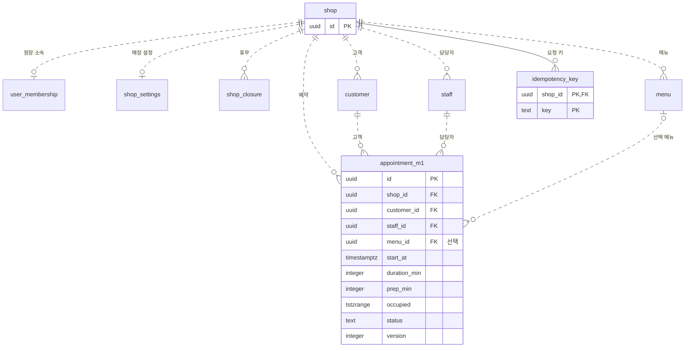

# M1 CRM ERD

카카오 로그인, 매장 설정, 고객 등록, 예약 등록 및 주간 캘린더의 시연 범위를 정리한다. 아래 9개 테이블에는 현재 예약 저장 경로가 쓰는 기존 `appointment`와 `appointment_event`가 포함되지 않는다.

- `user_membership.shop_id`와 `shop_settings.shop_id`는 고유하다. `staff`는 예약 배정 대상이다. 로그인 권한은 `user_membership`에서 관리한다.
- `shop_settings`에는 영업시간(`business_hours`), 환불 정책(`refund_policy`), 링크(`naver_place_url`, `instagram_url`, `landing_url`), 위치(`location_text`)가 있다. 신규 매장 설정은 DB가 생성한다. 앱은 `shop_closure`의 휴무를 등록·삭제할 수 있다. [BEA-166](https://linear.app/beautifulvoice/issue/BEA-166)
- 메뉴·담당자·고객·예약의 `version`과 `updated_at`은 수정 시 DB가 갱신한다. API는 받은 버전이 현재 값과 일치할 때만 수정한다.
- 예약은 `(shop_id, customer_id)`, `(shop_id, staff_id)`, `(shop_id, menu_id)`를 복합 FK로 써서 같은 매장 데이터만 연결한다. 매장별 접근은 RLS가 제한한다.
- 예약 점유 구간은 `[관리 시작 - 준비 시간, 관리 시작 + 관리 시간)`이다. 같은 매장·담당자의 점유 구간이 겹치면 DB가 저장을 거부한다. 영업시간·휴무 검사는 예약 쓰기 경로에서 처리한다. [BEA-177](https://linear.app/beautifulvoice/issue/BEA-177)
- 예약 `status`는 `scheduled`(예정), `completed`(완료), `cancelled`(취소), `no_show`(노쇼), `voided`(무효)다. 행의 비활성·삭제 정책과 `deleted_at` 적용 범위는 검토 중이다. [BEA-178](https://linear.app/beautifulvoice/issue/BEA-178)

전체 필드와 기본값은 [기준 데이터 SQL](../../apps/server/db/migrations/007-m1-crm-reference-data.sql)과 [예약 SQL](../../apps/server/db/migrations/008-m1-appointment-schema.sql)에 있다. 기존 예약 데이터 전환과 쓰기 API 연결은 후속 작업이다.
