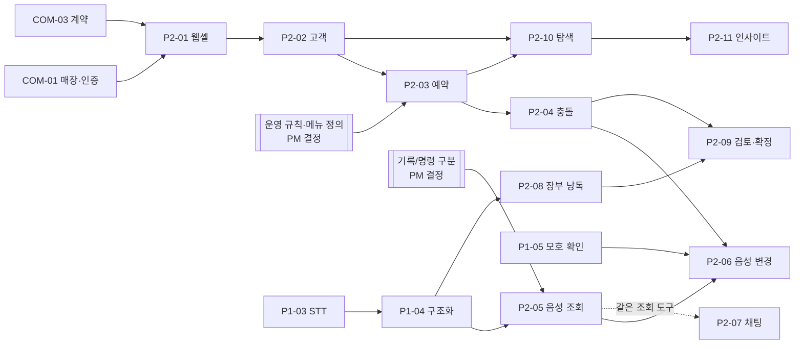

# 01. 제품 백로그 검토 — Phase 2 중심

> 작성: 개발팀 사전 검토 (초안) · 기준 문서: PM 제품·Phase 백로그 v1.0 (Slack 기획 자료 채널, 로컬 `docs/product/source/`)
> 상태: **화요일(11/17) 회의 입력용.** 공수는 상대 난도(S/M/L/XL)이며 스프린트 플래닝에서 다시 산정한다.
> 표기: **[사실]** 문서에 있음 · **[해석]** 개발팀 해석 · **[질문]** PM 확인 필요 (`06-pm-questions.md`의 번호)

## 1. 한 줄 요약

Phase 2의 CRM 기반(2A)은 기술 난도가 낮지만 **예약 운영 규칙·관리 항목(메뉴) 정의가 없으면 P2-03·04를 확정할 수 없고**, 2B(음성 조회·변경)는 **Phase 1의 STT·구조화 파이프라인과 '기록 vs 명령' 구분 정책**에 강하게 의존한다. 따라서 Phase 1·2는 "병렬 개발"이 가능하지만 **같은 저장소·같은 데이터 모델·같은 AI 파이프라인**을 공유해야 한다.

## 2. 공통 기반 (COM) — Phase 2의 선행 조건

| ID | 개발 해석 | 난도 | 불명확 사항 |
|---|---|---|---|
| COM-01 | 모든 테이블에 `shop_id`, API는 세션의 shop으로만 접근(행 수준 격리). 기기(마이크)도 shop에 귀속 | M | 로그인 방식·매장당 사용자 수 [질문 Q5] |
| COM-02 | 모든 AI 산출물에 `source_ref`(녹음·전사 버전·발화 구간) 저장, 정정은 덮어쓰기 대신 revision 추가 | M | 원본 음성 보관 기간 [질문 Q9] |
| COM-03 | OpenAPI 계약 + `Idempotency-Key` 헤더 + 공통 오류 형식 + 상태 enum. **화요일 전 고객·예약 계약 우선** [사실 4.4] | M | 없음(개발팀 결정 가능) |

## 3. Phase 2 항목별 검토

| ID | 기술 의존성 (선행) | 난도 | 핵심 구현 포인트 | 기획상 불명확 사항 |
|---|---|---|---|---|
| **P2-01** 웹셸·CRM 확장 | COM-01·03 | S | 단일 웹앱(모바일 우선 PWA 후보), 공통 라우팅·인증·빈 상태/오류 상태 컴포넌트 | 원장 주 사용 기기(폰/태블릿/PC) [Q2] |
| **P2-02** 고객 정보·기록 | P2-01, COM-02 | S | 고객 CRUD, 기록 연결(N:M 아님, 기록→고객 후보/확정 링크), **이름만으로 자동 병합 금지** | 고객 식별 필수 필드(전화번호 필수?) [Q8], 동의 항목 [Q9] |
| **P2-03** 예약 캘린더 | P2-02, 예약 필드 합의 | M | `tstzrange` 기반 예약, 상태 머신, 변경 이력(`appointment_event`) — P2-11 집계에 필요 | **예약 상태 목록**(요청/확정/취소/노쇼/완료?) [Q6], 관리 항목 마스터(메뉴·소요시간) [Q7] |
| **P2-04** 충돌 확인 | P2-03, 운영 규칙 | M | DB 수준 배타 제약(`EXCLUDE USING gist`)으로 동시 저장 충돌 차단 + 저장 전 사전 검사 API. 웹·음성·전화가 **같은 도메인 서비스** 호출 [사실 원칙 3] | 동시 수용 수(베드 수), 준비 시간, 영업시간·휴무 입력 주체, **원장 강제 저장(override) 허용 여부** [Q6] |
| **P2-05** 음성 조회 | P1-03·04, P2-02·03 | L | 의도 분류 → 정해진 **조회 도구(tool) 목록**으로만 DB 조회(자유 SQL 생성 금지) → 웹앱에 결과 표시 | "합의한 질문" 목록 미정 [Q11], **기록과 명령 구분 방식** [Q3] |
| **P2-06** 음성 CRM 변경 | P1-05, P2-02·04·05 | XL | AI는 `ActionProposal`(변경 전/후)만 생성 → 원장 승인 → 도메인 서비스 실행. 중복 요청 1회 반영(멱등키), 승인 대기 중 대상 변경 시 재확인 | 승인 UX(손을 못 쓰는 상황에서 웹 탭 승인?), 제안 만료 시간 [Q4] |
| **P2-07** 채팅 장부 질문 | COM-02, P2-02·03 | M~L | P2-05와 **같은 조회 도구** 재사용(입력만 텍스트). 답변에 근거 레코드 링크, 답변은 고객 기록으로 저장하지 않음 | 채팅 대화 보관 여부 |
| **P2-08** 장부 낭독 입력 | P1-03·04, P2-02 | L | 긴 낭독 음성 → 행 단위 분리 추출 → `import_batch`/`import_row`(저장 예정) | **장부 실물 샘플**, 낭독 대상 필드(과거 예약 이력 포함?) [Q10] |
| **P2-09** 장부 검토·확정 | P2-08, COM-03, P2-04 | M | 미리보기 편집·제외·확정, 중복 후보 매칭, 같은 배치 재처리 시 중복 저장 금지 | 과거 예약도 충돌 검사 대상인지 [Q10] |
| **P2-10** 고객·기간 탐색 | COM-02, P2-02·03 | S | 고객·기간 필터, 원문 링크 | 없음 |
| **P2-11** 기초 인사이트 | P2-03·10 | S | 매장 현지(Asia/Seoul) 날짜 기준 확정 예약 수, 취소 별도. 근거 목록 | 상태 정의가 P2-03과 같이 확정돼야 함 [Q6] |

### 난도 분포
- **S(낮음):** P2-01, 02, 10, 11 — 일반 CRUD·조회. AI 코드 생성으로 빠르게 가능.
- **M:** P2-03, 04, 09, P2-07 — 규칙·동시성·데이터 정합성이 핵심. 테스트 필수.
- **L~XL:** P2-05, 06, 08 — AI 파이프라인·평가(eval)·승인 흐름. **일정 리스크의 대부분.**

## 4. 의존성 그래프 (크리티컬 패스)

**크리티컬 패스:** COM → P2-01 → P2-02 → (운영 규칙 결정) → P2-03 → P2-04 → P2-06.
**외부 병목:** ① PM의 운영 규칙·메뉴 정의, ② Phase 1 STT·구조화 파이프라인, ③ 실물 음성 샘플.

## 5. 백로그 전반에 대한 개발 의견 (변경 제안 아님, 확인 요청)

1. **"Phase 1은 기획자 단독 개발 가능"[사실 0절]과 "Phase 1·2가 저장소를 각각 만들지 않는다"[사실 4.4]의 조율 필요.** 단독 개발하더라도 같은 저장소·같은 `recording`/`transcript` 모델·같은 PR 규칙을 따라야 2B 통합 비용이 없다. → [Q12]
2. **2B는 Phase 1 파이프라인의 소비자다.** 따라서 Phase 1의 P1-03·04는 "Phase 1 기능"이면서 동시에 Phase 2의 공통 인프라다. 우선순위 P-02 논의 시 반영 필요.
3. **AI 변경은 모두 `ActionProposal → 승인 → 실행` 한 가지 패턴으로 통일**할 것을 제안한다. P2-06, P2-09, P3-05~07(승인 후 처리)이 같은 테이블·같은 승인 UI를 재사용하게 되어 Phase 3B 비용이 크게 준다.
4. **P2-05/P2-07은 하나의 "질의 엔진"**(의도 → 조회 도구 → 근거 포함 답변)으로 구현하고 입력 채널(음성/채팅)만 다르게 한다.
5. **P2-03의 변경 이력**을 처음부터 이벤트로 남겨야 P2-11의 "변경 추이" 확장이 가능하다(나중에 소급 불가).
6. **P1-10(통화 중 수집)·Phase 3 전화**는 개인정보(통화 녹음 동의) 이슈가 있어 법적 검토 선행 필요. → `03-tech-risks.md` R7

## 6. 수용 기준 보완이 필요해 보이는 항목 (테스트 작성 관점)

| ID | 테스트로 옮기기 어려운 표현 | 필요한 정의 |
|---|---|---|
| P2-04 | "동시 수용 규칙" | 매장당 동시 예약 수 N, 준비 시간 분 단위, 영업시간 밖 예약 허용 여부 |
| P2-05 | "합의한 질문" | 지원 질문 10개 내외 목록과 기대 답변 예시 |
| P2-06 | "변경 전후 확인" | 승인 채널(웹 탭), 미승인 시 만료 시간, 승인 후 실패 시 표시 |
| P2-08 | "합의한 필드" | 장부 1행 = 어떤 필드(이름·연락처·날짜·관리·금액·메모?) |
| P2-11 | "확정 예약" | 상태 정의와 '확정' 전이 조건 |
| 공통 | "AI 정확도" | 최소 품질 기준(예: 고객명 인식률, 날짜 해석 정확도) — 초기엔 측정만 하고 기준은 파일럿 후 확정 가능 |
