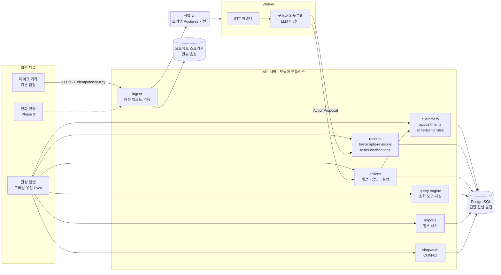
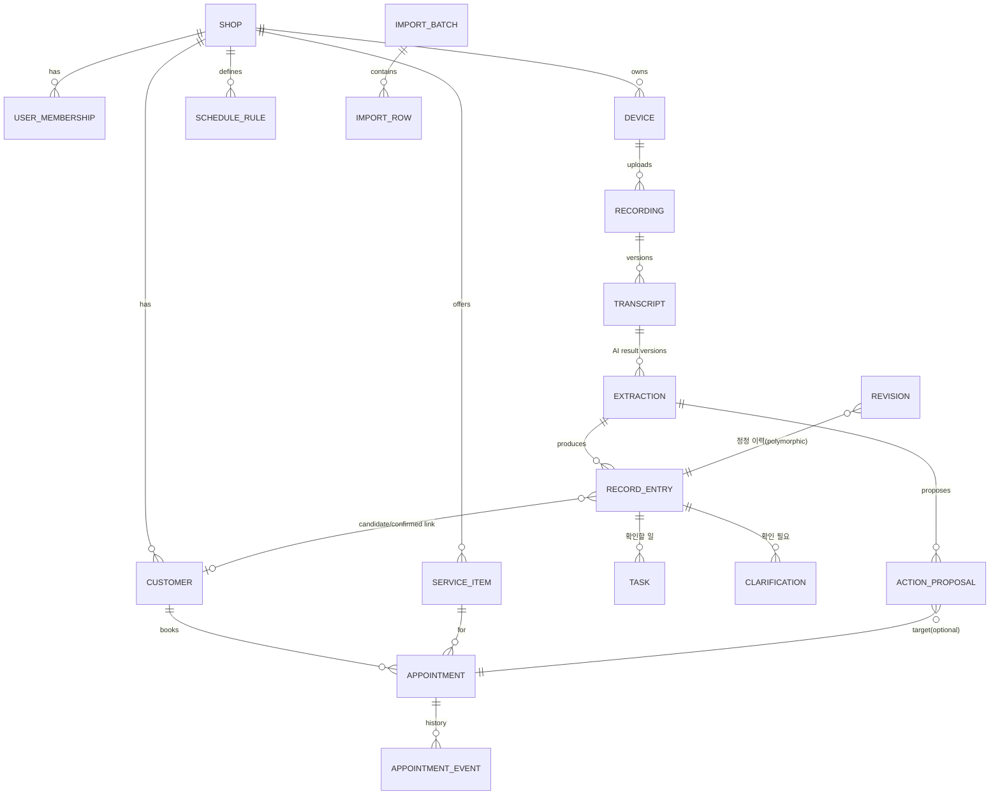

# 02. 아키텍처 초안

> 상태: **제안(Proposed).** 11/15 이전 프로젝트 코드 분석(비공개, §7 요약) 결과를 반영했다. D-03·D-06에서 확정한다.
> 구분: ✅ 개발팀 권고(되돌리기 쉬움/근거 충분) · 🟡 후보(기존 코드·PM 답변 후 결정) · ❓ PM 결정 필요

## 1. 설계 원칙 (PM 공통 원칙 → 기술 원칙)

| PM 원칙 | 기술 원칙 |
|---|---|
| 기록·요청·제안·승인·확정을 구분 | 상태 머신을 명시적으로 모델링. AI는 **제안(ActionProposal)만** 만들고, 확정은 도메인 서비스만 수행 |
| AI 변경은 원장 확인 후 실행 | 모든 쓰기 경로: `웹 UI` / `승인된 제안` → **같은 도메인 서비스** → DB |
| 같은 데이터·같은 예약 규칙 | 단일 DB, 단일 예약 서비스, 충돌은 DB 제약으로 최종 보장 |
| 실패·중복·정정도 기능 | 처리 단계별 상태 저장, 멱등키, revision 테이블, 원본 불변 |

## 2. 전체 구조 — 모듈형 모놀리스 + 비동기 워커 ✅

인원 3~4명·8주 일정에서 마이크로서비스는 과하다. **배포 단위 2개(API, Worker) + 웹앱 1개**로 시작하고, 내부는 도메인 모듈로 나눈다.



### 음성 처리 파이프라인 (Phase 1·2 공통)

```
업로드 수신(received) → 저장(stored) → 전사(transcribed) → 구조화(structured)
   → [기록] 기록·할 일·확인 필요 생성       (P1-04~07)
   → [조회 의도] 질의 엔진 → 웹앱 결과       (P2-05)
   → [변경 의도] ActionProposal → 원장 승인  (P2-06)
   → [장부 낭독] import_batch 저장 예정 목록  (P2-08)
각 단계 실패 시 failed_at_stage + 재시도 가능, 원본은 불변
```
- 기록 vs 명령 구분 방식은 ❓[Q3]. 구조상으로는 "구조화 단계의 의도 분류 결과"로 분기하므로 **어떤 정책이든 수용 가능**하게 설계한다.

## 3. 공통 데이터 모델 (초안) 🟡

> 모든 테이블: `id(uuid)`, `shop_id`, `created_at`, `updated_at`. 시간은 UTC `timestamptz` 저장, 표시·집계는 매장 시간대(`shop.timezone`, 기본 Asia/Seoul).
> 기존 코드의 스키마를 참고해 필드명을 조정한다.



| 엔티티 | 핵심 필드 | 백로그 |
|---|---|---|
| `shop` | name, timezone, 영업 설정 | COM-01 |
| `user_membership` | user_id, role(owner/staff?) | COM-01 ❓Q5 |
| `device` | serial, auth_token_hash, last_seen | P1-01 |
| `recording` | device_id, client_recording_id(**멱등키**), recorded_at(기기), received_at(서버), object_key, duration, status, failed_stage | P1-01·02 |
| `transcript` | recording_id, version, provider, text, segments(json, 타임스탬프) | P1-03 |
| `extraction` | transcript_id, model, prompt_version, intent, payload(json), confidence | P1-04 |
| `record_entry` | extraction_id, occurred_on(업무 날짜), entry_type, summary, customer_id?, status | P1-06 |
| `task` / `clarification` | record_entry_id, evidence_span, status(open/done/dismissed) | P1-05·07 |
| `revision` | target_type, target_id, before, after, actor, reason | COM-02, P1-09 |
| `customer` | name, phone?(정규화 저장, **필수 아님** — 원장 메모·장부에서 전화번호 없이 생성 가능), birth_partial?, memo, archived_at, erasure_requested_at(보관·파기 분리), (동의 항목?) | P2-02 ❓Q8 |
| `service_item` | name, duration_min, prep_min, cleanup_min, price?, active | P2-03·04 ❓Q7 |
| `schedule_rule` | business_hours, closed_days, capacity | P2-04 ❓Q6 |
| `appointment` | customer_id, service_item_id, `period tstzrange`(준비·정리 포함 **점유 구간**), service_snapshot(예약 시점 메뉴명·소요·가격), status, source(web/voice/phone/import), version | P2-03 |
| `appointment_event` | appointment_id, type, before, after, actor, source_ref | P2-03·11 |
| `action_proposal` | kind, target_ref, target_version(제안 시점 레코드 버전), preview_hash(원장이 본 미리보기), before, after, status(pending/approved/rejected/expired/superseded/executed/failed), idempotency_key, expires_at, superseded_by, source_ref | P2-06, P3-06·07 |
| `import_batch` / `import_row` | recording_id, row_payload, match_candidates, decision | P2-08·09 |
| `job` (큐) | type, payload, attempts, status | P1-02 |

**충돌 보장 (P2-04) 예시** — 동시 수용 1명 기준:
```sql
ALTER TABLE appointment ADD CONSTRAINT no_overlap
  EXCLUDE USING gist (shop_id WITH =, period WITH &&)
  WHERE (status IN ('confirmed'));
```
동시 수용 N>1이면 리소스(베드) 단위 컬럼을 추가하거나 트랜잭션 내 잠금+카운트로 처리 → ❓Q6 결과에 따라 결정.
- 애플리케이션 메모리 검사만으로는 동시 저장 시 이중 예약이 생긴다(이전 코드에서 확인된 결함). **DB 제약 + 병렬 저장 테스트(S4)를 필수**로 한다.
- `CHECK (upper(period) > lower(period))`, 영업시간·휴무 검사는 도메인 서비스에서 저장 직전에 수행(조회용 가용성 API가 검사를 생략하지 않도록 같은 함수 사용).

**테넌트 격리 (COM-01) ✅** — [ADR-0003](../adr/0003-tenant-isolation-forced-rls.md)
- 모든 업무 테이블에 `ENABLE` + **`FORCE ROW LEVEL SECURITY`**, 정책은 세션 변수 `app.shop_id` 기준.
- 테이블 간 FK는 **`(shop_id, id)` 복합 키**로 걸어 다른 매장 레코드를 참조할 수 없게 한다.
- 앱 DB 역할은 superuser·`BYPASSRLS` 금지. 서버 시작 시 역할 권한을 검사해 위반이면 기동 거부.
- 시각은 `timestamptz`로만 비교한다(문자열 비교 금지 — 이전 코드 결함).

**의도 분류 (구조화 단계 출력)** — 기록(받아쓰기) / 조회 / 변경 요청 / 장부 낭독 / 판단 불가. 플래그: 부정·정정("아니 3시 말고 4시")·복수 의도·원장 판단 필요(의료·환불 등). 한 녹음에 의도가 섞이는 경우의 처리 방식은 ❓Q3·Q16.

## 4. 주요 인터페이스 (계약 초안) 🟡

계약은 **OpenAPI 3 단일 파일**을 원천으로 하고, 서버 검증·클라이언트 타입을 생성한다. 변경은 `contract-change` 스킬 절차를 따른다.

| 인터페이스 | 방향 | 요지 |
|---|---|---|
| `POST /v1/devices/{id}/recordings` | 기기→API | multipart 오디오 + `Idempotency-Key`(= client_recording_id) + recorded_at. 동일 키 재전송 시 기존 리소스 200 반환 |
| `GET /v1/recordings/{id}` | 웹·기기 | 처리 상태(`received/stored/transcribed/structured/failed`) + failed_stage |
| `GET/POST/PATCH /v1/customers` | 웹 | 고객 CRUD, 중복 후보 조회 `GET /v1/customers/match?name=&phone=` |
| `POST /v1/appointments:check` | 웹·AI | 저장 없이 충돌·영업시간 검사 결과 반환 |
| `POST/PATCH /v1/appointments` | 웹·실행기 | 저장 직전 재검사, 충돌 시 `409 APPOINTMENT_CONFLICT` |
| `GET /v1/inbox` | 웹 | 시간순 기록·할 일·확인 필요·실패 (P1-08) |
| `POST /v1/revisions` | 웹 | 정정 → 재정리 작업 트리거 (P1-09) |
| `GET /v1/action-proposals?status=pending` / `POST …/{id}:approve|reject` | 웹 | 승인 흐름 (P2-06, P3-06) |
| `POST /v1/queries` | 웹(채팅)·워커(음성) | 질의 엔진. 응답 = 답변 + 근거 레코드 목록 (P2-05·07) |
| `POST /v1/imports/{id}:commit` | 웹 | 장부 배치 확정 (P2-09) |

공통 규약 ✅: 오류 `{ code, message, details }`, 페이지네이션 cursor 방식, 모든 쓰기 API는 `Idempotency-Key` 허용, 시각은 ISO-8601 + offset.

### AI 경계 (보안·신뢰성) ✅
- LLM은 **정해진 도구(조회 함수)·정해진 JSON 스키마 출력**만 사용. 자유 SQL·자유 쓰기 금지.
- **AI 출처 요청은 설정·모드와 무관하게 항상 `ActionProposal`**(ADR-0002). 승인 여부는 웹앱 탭(결정론적)으로만 받고, "네/좋아요" 같은 말을 모델이 승인으로 해석하지 않는다.
- **그라운딩:** 구조화 결과의 값(이름·날짜·전화·가격·소요)은 전사문에서 근거 구간을 찾을 수 있어야 한다. 근거 없는 값은 버리고 `null` + 확인 필요로 둔다(후처리 코드로 검증).
- 원장 지침·매장 정보를 **대화로 영구 수정하는 기능은 두지 않는다**(지속형 프롬프트 인젝션 경로). 설정은 웹 화면에서만 변경.
- 모든 AI 호출 기록: model, prompt_version, 입력 참조, 출력, 지연, 비용 → 품질 평가·회귀 테스트(eval)용.
- STT·LLM은 **어댑터 인터페이스**로 감싸 벤더 교체 가능하게(스파이크 결과에 따라 결정).

## 5. 기술 스택 후보 🟡 (D-06에서 결정)

| | A. TypeScript 단일 언어 | B. React + Python API | C. BaaS(Supabase 등) 중심 |
|---|---|---|---|
| 구성 | pnpm 모노레포: `apps/web`(React/Next 또는 Vite PWA), `apps/api`(Fastify/Nest), `apps/worker`, `packages/contracts` | `web`(React) + `api`(FastAPI) + `worker`(arq/Celery) | Postgres·Auth·Storage 관리형 + 웹 + 별도 워커 |
| 장점 | 계약 타입 공유, 한 언어로 3인 협업·AI 코드 생성 효율, 리뷰 부담↓ | 오디오·AI 라이브러리 풍부, **기존 코드가 Python이면 재사용** | 인증·RLS·스토리지 즉시 사용, 초기 속도 최고 |
| 단점 | 로컬 오디오 처리 라이브러리 약함(대부분 외부 API라 영향 작음) | 2개 언어, OpenAPI 코드 생성 필수 | 벤더 종속, 장시간 STT 작업에 별도 워커 필요, 국내 리전·개인정보 검토 |
| 개발팀 1차 의견 | **기본 권고** — 외부 STT/LLM API 호출 중심이므로 언어 이점이 큼 | 기존 코드가 Python이고 AI 파이프라인 재사용 가치가 높으면 선택 | 일정 압박이 매우 크면 검토 |

**이전 코드 분석 시사점:** 이전 프로젝트 3개 모두 TypeScript(Bun)였으나 **코드는 새로 작성**하기로 제안하므로(§7) 언어 선택의 결정적 근거는 아니다. A안에 약간 유리. Bun 채택은 별도 판단.

**스택 무관 고정 권고 ✅:** PostgreSQL(범위 타입·배타 제약·JSONB), S3 호환 오브젝트 스토리지, OpenAPI 계약, Docker 기반 로컬 환경, GitHub Actions CI.
**호스팅 🟡:** 개인정보(고객 음성·연락처)를 다루므로 **국내 리전**(예: AWS 서울, NCP 등) 우선 검토. 해외 AI API로의 음성·텍스트 전송은 ❓Q9(국외 이전 고지·동의) 확인 후 결정.

## 6. 환경 구성 (D-08 초안)

| 환경 | 용도 | 데이터 | 배포 |
|---|---|---|---|
| local | 개발 | 시드·합성 데이터만 | `docker compose` |
| staging | 통합·PM 확인·기기 연결 테스트 | 합성 + 카본 테스트 녹음 | `main` 머지 시 자동 |
| production | 파일럿 | 실제 고객 데이터 | 태그/릴리스 + 수동 승인 |

- 실제 고객 데이터는 production 밖으로 복사하지 않는다. AI 도구(코딩 어시스턴트)에 실데이터를 붙여넣지 않는다.
- 비밀값: GitHub Environments secrets + 클라우드 시크릿 매니저. 저장소에는 `.env.example`만.
- 마이그레이션: 전진 전용(forward-only), PR에 SQL 포함, staging 먼저 적용.

## 7. 이전 프로젝트 코드 재사용 방침 (D-03 제안) — [ADR-0005](../adr/0005-legacy-code-reuse-policy.md)

카본 님이 공유한 이전 프로젝트(전화 에이전트 / CRM 본체 / 음성 CRM 런타임, 비공개)를 `legacy-code-analysis` 스킬로 분석했다. 상세 보고서는 비공개 폴더(`.private/analysis/`, git 제외)에 있다.

**결론: 설계·스키마·규칙·tool 정의는 참고, 코드는 새로 작성.** 이유: 세 코드의 저장소 모델이 서로 다르고(단일 매장 SQLite / 멀티 매장 Postgres / 데모 전용), 핵심 경로가 양방향 실시간·AI 직접 확정 전제이며, 동시 이중 예약 미방지 등 구조적 결함이 있다.

| 가져옴(설계 그대로) | 참고(새로 작성) | 버림 |
|---|---|---|
| 강제 RLS·복합 FK·역할 가드, 한국어 금액·날짜 포맷, 이름+조사 검색 변형, ISO offset·전화번호 검증 | 메뉴·예약·고객 필드 설계, 제안→승인 모델(버전·미리보기 결속·만료·대체), 멱등 패턴, 조회 tool 세트, 그라운딩 규칙, 작업·보고서 생명주기, 문의 사유·작업 분류 | 실시간 음성 전부(VAD·말 끊기·TTS·스트리밍), 파인튜닝 트랙, 결제·이용권·환불, 기존 UI, 대화로 지침 영구 수정 기능 |

- 이식 전 **코드 권리 관계 확인 필요**(❓Q22).
- Phase 3A 전화 응대는 직접 구현보다 **관리형 음성 런타임 우선 검토**([ADR-0004](../adr/0004-phase3a-managed-voice-runtime.md)).

