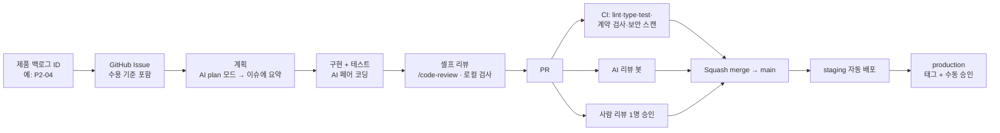

# 04. 개발 규칙 초안 — AI 네이티브 개발 프로세스

> 상태: 초안. 화요일 D-07·D-08·D-09에서 확정. 확정 후 이 문서와 `CLAUDE.md`가 공식 규칙이다.
> 기본 원칙: **AI는 적극 사용하되, 머지된 코드의 책임은 PR 작성자와 승인자에게 있다.**

## 1. 전체 흐름 (이슈 → 배포)



## 2. Git

| 항목 | 규칙 |
|---|---|
| 브랜치 전략 | **트렁크 기반.** `main` 보호, 짧은 기능 브랜치(가능하면 2일 이내 머지) |
| 브랜치 이름 | `<type>/<issue번호>-<짧은설명>` 예: `feat/42-appointment-conflict` |
| 커밋 메시지 | Conventional Commits: `feat(appointments): 저장 직전 충돌 재검사 (#42)` |
| 머지 방식 | Squash merge만 허용. PR 제목이 최종 커밋 메시지 |
| `main` 보호 (목표) | 직접 push 금지, CI 통과 + 승인 1명 필수, 대화(리뷰 코멘트) 해결 필수, 새 커밋이 올라오면 기존 승인 무효화(Dismiss stale approvals), CODEOWNERS 승인 필수, Squash만 |
| `main` 보호 (현재 적용) | ruleset `main-protection`: PR 필수·직접 push/강제 push/삭제 금지·코멘트 해결 필수·승인 무효화·Squash만·**승인 1명**(11/16 팀원 초대 후 상향). CODEOWNERS·CI 필수 미적용 — CODEOWNERS 작성 시 해당 옵션, CI 작성 시 status check를 켠다. **작성자 본인은 승인할 수 없으므로 모든 PR은 다른 팀원 1명의 승인이 필요하다** |
| 큰 기능 | 피처 플래그로 미완성 기능을 숨기고 `main`에 자주 통합 (장기 브랜치 금지) |

## 3. 이슈 관리 (D-09 초안)

- **공식 작업 기록: GitHub Issues + Projects 보드** (코드·PR과 자동 연결되므로). 제품 결정은 PM 문서·Notion 등 PM이 정한 위치, 기술 결정은 `docs/adr/`.
- 이슈 유형: `story`(백로그 기반), `bug`, `spike`, `chore`. 템플릿은 `.github/ISSUE_TEMPLATE/`.
- 모든 story 이슈는 **백로그 ID와 수용 기준**을 포함한다. 수용 기준이 테스트로 옮겨지지 않으면 PM에게 질문 후 착수.
- **채팅(Slack) 결정은 결정한 사람이 24시간 내 이슈/ADR/PM 문서에 반영**하고 링크를 남긴다.
- 라벨: `phase:1|2|3`, `area:web|api|ai|infra|hw`, `type:*`, `blocked:pm`, `needs-owner-check`, `ai-review:skip`.
- `ai-review:skip`은 **`docs/**`만 바뀐 PR 또는 자동 생성 PR(락파일·의존성 갱신)**에만 쓴다. 붙인 사람은 PR 본문에 사유를 적고, 리뷰어는 변경 파일이 조건에 맞는지 확인한다. skip된 체크도 success로 표시되므로 "리뷰됨"과 "건너뜀"은 PR 코멘트 유무로 구분한다(워크플로가 skip 사유를 요약에 남기도록 하는 개선은 다음 워크플로 PR에서).

## 4. PR·코드 리뷰

| 항목 | 규칙 |
|---|---|
| 크기 | 변경 400줄 이하 권장(생성 파일·락파일 제외). 넘으면 쪼개거나 사유 기재 |
| 설명 | PR 템플릿 필수: 연결 이슈, 무엇/왜, 테스트 방법, 스크린샷(UI), **AI 사용 범위**, 위험·롤백 |
| 리뷰어 | 사람 1명 승인 필수(목표 — 현재 적용 상태는 §2). 계약(`contracts/`)·DB 마이그레이션·인증 코드·**CI/CD 워크플로(`.github/workflows/`)**는 지정 담당 승인 필수(CODEOWNERS). CODEOWNERS 파일은 R&R 확정 후 담당자 2명 이상으로 작성(작성자 본인은 승인 불가하므로). **작성 전까지는** 이 경로를 바꾸는 PR에 `needs-owner-check` 라벨을 붙이고 저장소 관리자가 직접 확인한 뒤 머지한다 |
| AI 리뷰 | PR을 **열 때(또는 Draft→Ready) 1회 자동 리뷰**. push마다 다시 돌지 않는다. 수정 후 다시 보고 싶으면 PR에 `/review` 코멘트(직전 리뷰 이후 변경분만, 요청자 토큰). §6 "AI 리뷰가 건너뛰어지는 경우"는 제외 — 이때는 사람 리뷰가 유일한 안전장치. **AI 리뷰는 보조이며 승인을 대체하지 않는다** |
| AI 리뷰 반영 | **🔴 필수만 반영 의무**(버그·보안·개인정보·수용 기준·멱등·충돌 규칙·테스트 누락). 🟡 제안·❔ 질문은 요약 코멘트에만 오며, 작성자가 판단해 반영하거나 "반영 안 함 + 이유"로 끝낸다. 인라인 코멘트는 🔴만 달리므로 "코멘트 해결 필수"는 🔴 해결을 뜻한다. 같은 PR에서 재리뷰는 필요할 때만 요청해 리뷰↔수정 루프를 만들지 않는다 |
| 응답 시간 | 리뷰 요청 후 업무일 기준 24시간 내 1차 응답 |
| 머지 시점 | 작성자가 "push 완료"를 알린 뒤 머지. 승인 후 새 커밋이 오면 승인이 자동 무효화되므로 다시 승인받는다 |
| 리뷰 관점 | ① 수용 기준 충족 ② 테스트 ③ 보안·개인정보(shop 격리, 로그에 개인정보 없음) ④ 멱등·실패 처리 ⑤ 계약 일치 |

## 5. AI 활용 규칙과 책임 범위

### 적극 활용 영역
- 계획(plan 모드), 구현, 테스트 작성, 리팩터링, 문서, 리뷰, 이슈/ADR 초안, 로그 분석.
- 반복 작업은 **프로젝트 스킬**(`.claude/skills/`)로 만들어 팀이 같은 방식으로 수행한다.
  - `story-to-issue`: 백로그 ID → 수용 기준이 포함된 이슈 초안
  - `write-adr`: 기술 결정 → ADR
  - `contract-change`: API 계약 변경 절차(계약 → 타입 생성 → 서버/클라이언트 → 테스트)
  - `legacy-code-analysis`: 이전·외부 코드를 새 Phase 기준으로 분석(가져옴/참고/교훈/폐기). 대상 코드 실행 금지, 보고서는 `.private/`에만
- 공용 컨텍스트는 `CLAUDE.md`에 둔다. 개인 설정은 `CLAUDE.local.md`(git 제외).

### 책임
1. **PR 작성자가 모든 줄을 설명할 수 있어야 한다.** "AI가 썼다"는 리뷰 답변이 될 수 없다.
2. AI가 만든 로직은 **테스트로 검증**한다. 테스트 없는 도메인 로직(예약·권한·멱등)은 머지 금지.
3. AI 생성 테스트는 "구현을 그대로 베낀 테스트"인지 확인한다(수용 기준에서 출발했는지).
4. 의존성 추가는 PR 설명에 이유를 쓴다. AI가 제안한 패키지는 실존·유지보수 여부를 확인한다(패키지 환각 방지).

### 금지
- 실제 고객 데이터·음성·비밀값(API 키, 토큰)을 AI 도구 프롬프트에 넣지 않는다. 디버깅은 합성 데이터로.
- AI 에이전트에 production 접근 권한·배포 권한을 주지 않는다.
- AI 에이전트가 `main`에 직접 push하거나 리뷰 없이 머지하지 않는다.

### 제품 기능의 AI(LLM·STT) 변경 규칙
- 프롬프트·모델 변경은 코드 변경과 동일하게 PR로 관리하고 `prompt_version`을 올린다.
- 프롬프트 변경 PR은 **eval(골든 세트) 결과를 첨부**한다. 정확도가 떨어지면 사유를 기재.

## 6. CI/CD

| 단계 | 트리거 | 내용 | 상태 |
|---|---|---|---|
| AI 리뷰 | PR 열 때·Ready 전환·`/review` 코멘트 | `.github/workflows/ai-review.yml` (Claude Code Action, **PR 작성자 본인 구독 토큰**) | 동작 중. 팀원별 토큰 등록 필요(아래) |
| 문서 검사 | PR | Markdown 링크·형식 검사 | 스택 결정 후 CI에 통합 |
| CI | PR, main push | lint · typecheck · unit test · 계약 검사(OpenAPI diff) · 마이그레이션 검사 · 의존성/시크릿 스캔 | **스택 결정 후 작성** |
| AI eval | `ai/` 또는 프롬프트 변경 PR | 골든 세트 정확도 리포트 코멘트 | 스파이크 S2 이후 |
| CD staging | main 머지 | 자동 배포 + 스모크 테스트 | 호스팅 결정 후 |
| CD production | 릴리스 태그 | 수동 승인(GitHub Environment) 후 배포, 마이그레이션 선행 | 호스팅 결정 후 |

- 의존성 업데이트: Dependabot/Renovate 주 1회 묶음 PR.
- 시크릿: GitHub Environments(`staging`, `production`)로 분리, production은 승인자 지정.

### AI 리뷰 토큰 — 각자 본인 구독으로
AI 리뷰(`ai-review.yml`)는 **PR 작성자**, `@claude`(`claude.yml`)는 **호출한 사람**의 Claude 구독 토큰을 쓴다. 사용량이 한 사람에게 몰리지 않게 하기 위함이다.

| Secret 이름 | 용도 |
|---|---|
| `CLAUDE_TOKEN_<GitHub 아이디>` | 팀원 본인 토큰. 아이디는 대문자, 영숫자 외 문자는 `_` (예: `parkganghyun123-sketch` → `CLAUDE_TOKEN_PARKGANGHYUN123_SKETCH`) |
| `CLAUDE_CODE_OAUTH_TOKEN` | 공용 대체 토큰. 본인 토큰 미등록 시에만 사용되고 실행 요약에 경고가 남는다 |

등록 절차 (팀원 1인당 1회):
1. **팀원:** 저장소 Collaborator 초대를 수락하고, fork가 아닌 이 저장소 브랜치로 PR을 연다 (fork PR에는 Secret이 전달되지 않아 리뷰가 돌지 않음).
2. **팀원:** 터미널 창을 넓게 만든 뒤 `claude setup-token` 실행 → `sk-ant-oat01-…` 토큰이 한 줄로 보이는지 확인(아직 복사하지 않음).
3. **등록:** 저장소 Secrets 쓰기 권한(관리자)이 있는 사람의 **실제 터미널 탭**에서 스크립트를 실행하고, 프롬프트가 뜨면 토큰 한 줄만 복사해 붙여넣고 Enter. zsh·bash 모두 같은 명령이다.
   ```bash
   bash scripts/register-claude-token.sh <GitHub 아이디>
   ```
   - 스크립트는 공백 제거 → 형식(`sk-ant-oat01-`) 확인 → **토큰으로 Claude를 실제 호출해 종료 코드 0일 때만** Secret 등록(호출 1회만큼 사용량 차감). 실패하면 원인 메시지(토큰은 `[REDACTED]` 처리)를 보여 주고 아무것도 등록하지 않는다. 토큰은 화면에 출력하지 않는다.
   - 길이가 100자보다 한참 짧으면 복사 중 잘린 것이니 다시 복사한다.
   - 토큰을 Slack·카톡·이슈·AI 프롬프트에 붙여넣지 않는다. 관리자 터미널에서 팀원이 직접 입력한다(토큰 등록을 위해 Admin 권한을 따로 부여하지 않는다).
   - 스크립트는 길이 80자 미만이면 거부하고, 검증 호출 시 `ANTHROPIC_API_KEY` 등 다른 자격증명을 제거해 가짜 통과를 막는다. 오류 출력의 `sk-ant-…` 패턴은 모두 가린다.
   - 실제 발생 사례: ① 붙여넣기에 앞 공백이 섞여 인증 실패 ② `pbpaste` 방식은 명령어를 복사하는 순간 클립보드의 토큰이 덮여 **명령어 문자열이 등록**됨 ③ 화면에서 잘린 토큰이 형식 검사만 통과해 등록됨 ④ 앱 대화창의 `!` 명령 입력에서는 대화형 입력이 안 돼 아무것도 등록되지 않음. 그래서 위 스크립트만 쓴다.
4. 토큰이 유출됐거나 팀을 떠나면 해당 Secret을 삭제하고 Claude 계정에서 토큰을 폐기한다.
5. 등록 확인: 본인 PR의 Actions 실행 요약에 "✅ PR 작성자 본인 토큰"이 보이면 정상, "⚠️ 미등록"이면 Secret 이름을 확인한다. "✅"인데 `Claude execution failed: result is_error:true`로 실패하면 토큰 값(공백·잘림·만료) 또는 구독 사용량 한도를 의심한다.

### 알려진 보안 한계 — 저장소 Secret (화요일 D-07에서 수용 여부 결정)
- `CLAUDE_TOKEN_*`는 **저장소 레벨 Secret**이다. 쓰기 권한이 있는 Collaborator는 자기 브랜치에 `on: push` 워크플로를 올려 **다른 팀원의 토큰을 읽을 수 있다.** `ai-review.yml`의 main 버전 검증·ruleset은 이 경로를 막지 못한다.
- 현재 판단(안): 4인 신뢰 팀이므로 **수용**하되, ① 토큰은 언제든 폐기·재발급 가능 ② 사용량 이상 시 즉시 폐기 ③ 다른 사람의 Secret을 읽는 워크플로 작성은 금지(위반은 신뢰 문제로 다룸).
- 강화안(필요 시): 토큰을 `main`에서만 쓸 수 있는 **Environment Secret**으로 옮기고 리뷰 워크플로를 `pull_request_target`(main 버전 실행) + 협업자 한정으로 바꾼다. 구조 변경이 커서 별도 워크플로 PR로 진행.

### AI 리뷰가 건너뛰어지는 경우 (정상 동작)
- **워크플로 파일(`.github/workflows/`)을 수정하는 PR:** 보안 검증상 `main`과 같은 워크플로만 실행되므로 리뷰가 skip된다(체크는 success로 표시). 가장 민감한 변경이므로 §4에 따라 **CODEOWNERS 필수 승인** 대상이다.
- Draft PR, `ai-review:skip` 라벨이 붙은 PR, fork에서 올린 PR.
- 다음 워크플로 PR 예정: `ai-review:skip` 라벨이 `docs/**` 외 파일 변경 PR에 붙으면 무시하고 리뷰를 실행, skip 사유를 실행 요약에 기록.

## 7. 코드 컨벤션 (스택 결정 후 구체화)
- 포매터·린터는 CI에서 강제, 스타일 논쟁은 리뷰에서 하지 않는다.
- 도메인 규칙(예약 충돌, 상태 전이, 권한)은 UI·라우터가 아닌 **도메인 서비스**에 둔다.
- 로그에 개인정보(이름·전화번호·전사문) 원문을 남기지 않는다. ID로 참조.

## 8. 데일리 스크럼 (안건 9 초안)
- 비동기 Slack 스레드 매일 오전 10시까지: ① 어제 한 것(PR/이슈 링크) ② 오늘 할 것 ③ 막힌 것(`blocked:pm`이면 PM 태그).
- 주 1회 동기 회의(30분)에서 리뷰·조정. 스프린트 리뷰·회고는 스프린트 종료일.
