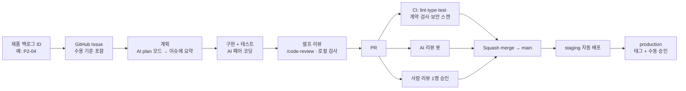

# 04. 개발 규칙 초안 — AI 네이티브 개발 프로세스

> 상태: 초안. 화요일 D-07·D-08·D-09에서 확정. 확정 후 이 문서와 `CLAUDE.md`가 공식 규칙이다.
> 기본 원칙: **AI는 적극 사용하되, 머지된 코드의 책임은 PR 작성자와 승인자에게 있다.**

## 1. 전체 흐름 (이슈 → 배포)

## 2. Git

| 항목 | 규칙 |
|---|---|
| 브랜치 전략 | **트렁크 기반.** `main` 보호, 짧은 기능 브랜치(가능하면 2일 이내 머지) |
| 브랜치 이름 | `<type>/<issue번호>-<짧은설명>` 예: `feat/42-appointment-conflict` |
| 커밋 메시지 | Conventional Commits: `feat(appointments): 저장 직전 충돌 재검사 (#42)` |
| 머지 방식 | Squash merge만 허용. PR 제목이 최종 커밋 메시지 |
| `main` 보호 | 직접 push 금지, CI 통과 + 승인 1명 필수, 대화(리뷰 코멘트) 해결 필수 |
| 큰 기능 | 피처 플래그로 미완성 기능을 숨기고 `main`에 자주 통합 (장기 브랜치 금지) |

## 3. 이슈 관리 (D-09 초안)

- **공식 작업 기록: GitHub Issues + Projects 보드** (코드·PR과 자동 연결되므로). 제품 결정은 PM 문서·Notion 등 PM이 정한 위치, 기술 결정은 `docs/adr/`.
- 이슈 유형: `story`(백로그 기반), `bug`, `spike`, `chore`. 템플릿은 `.github/ISSUE_TEMPLATE/`.
- 모든 story 이슈는 **백로그 ID와 수용 기준**을 포함한다. 수용 기준이 테스트로 옮겨지지 않으면 PM에게 질문 후 착수.
- **채팅(Slack) 결정은 결정한 사람이 24시간 내 이슈/ADR/PM 문서에 반영**하고 링크를 남긴다.
- 라벨: `phase:1|2|3`, `area:web|api|ai|infra|hw`, `type:*`, `blocked:pm`, `ai-review:skip`(문서 전용 등 예외).

## 4. PR·코드 리뷰

| 항목 | 규칙 |
|---|---|
| 크기 | 변경 400줄 이하 권장(생성 파일·락파일 제외). 넘으면 쪼개거나 사유 기재 |
| 설명 | PR 템플릿 필수: 연결 이슈, 무엇/왜, 테스트 방법, 스크린샷(UI), **AI 사용 범위**, 위험·롤백 |
| 리뷰어 | 사람 1명 승인 필수. 계약(`contracts/`)·DB 마이그레이션·인증 코드는 영역 주담당 승인 필수(CODEOWNERS) |
| AI 리뷰 | 모든 PR에 자동 AI 리뷰 실행. **AI 리뷰는 보조이며 승인을 대체하지 않는다.** 지적 사항은 반영하거나 반박 코멘트를 남긴다 |
| 응답 시간 | 리뷰 요청 후 업무일 기준 24시간 내 1차 응답 |
| 리뷰 관점 | ① 수용 기준 충족 ② 테스트 ③ 보안·개인정보(shop 격리, 로그에 개인정보 없음) ④ 멱등·실패 처리 ⑤ 계약 일치 |

## 5. AI 활용 규칙과 책임 범위

### 적극 활용 영역
- 계획(plan 모드), 구현, 테스트 작성, 리팩터링, 문서, 리뷰, 이슈/ADR 초안, 로그 분석.
- 반복 작업은 **프로젝트 스킬**(`.claude/skills/`)로 만들어 팀이 같은 방식으로 수행한다.
  - `story-to-issue`: 백로그 ID → 수용 기준이 포함된 이슈 초안
  - `write-adr`: 기술 결정 → ADR
  - `contract-change`: API 계약 변경 절차(계약 → 타입 생성 → 서버/클라이언트 → 테스트)
- 공용 컨텍스트는 `CLAUDE.md`에 둔다. 개인 설정은 `CLAUDE.local.md`(git 제외).

### 책임
1. **PR 작성자가 모든 줄을 설명할 수 있어야 한다.** "AI가 썼다"는 리뷰 답변이 될 수 없다.
2. AI가 만든 로직은 **테스트로 검증**한다. 테스트 없는 도메인 로직(예약·권한·멱등)은 머지 금지.
3. AI 생성 테스트는 "구현을 그대로 베낀 테스트"인지 확인한다(수용 기준에서 출발했는지).
4. 의존성 추가는 PR 설명에 이유를 쓴다. AI가 제안한 패키지는 실존·유지보수 여부를 확인한다(패키지 환각 방지).

### 금지
- 실제 고객 데이터·음성·비밀값(API 키, 토큰)을 AI 도구 프롬프트에 넣지 않는다. 디버깅은 합성 데이터로.
- AI 에이전트에 production 접근 권한·배포 권한을 주지 않는다.
- AI 에이전트가 `main`에 직접 push하거나 리뷰 없이 머지하지 않는다.

### 제품 기능의 AI(LLM·STT) 변경 규칙
- 프롬프트·모델 변경은 코드 변경과 동일하게 PR로 관리하고 `prompt_version`을 올린다.
- 프롬프트 변경 PR은 **eval(골든 세트) 결과를 첨부**한다. 정확도가 떨어지면 사유를 기재.

## 6. CI/CD

| 단계 | 트리거 | 내용 | 상태 |
|---|---|---|---|
| AI 리뷰 | PR 열림/갱신 | `.github/workflows/ai-review.yml` (Claude Code Action, **구독 토큰** 인증) | 작성됨, `CLAUDE_CODE_OAUTH_TOKEN` 등록 필요 |
| 문서 검사 | PR | Markdown 링크·형식 검사 | 스택 결정 후 CI에 통합 |
| CI | PR, main push | lint · typecheck · unit test · 계약 검사(OpenAPI diff) · 마이그레이션 검사 · 의존성/시크릿 스캔 | **스택 결정 후 작성** |
| AI eval | `ai/` 또는 프롬프트 변경 PR | 골든 세트 정확도 리포트 코멘트 | 스파이크 S2 이후 |
| CD staging | main 머지 | 자동 배포 + 스모크 테스트 | 호스팅 결정 후 |
| CD production | 릴리스 태그 | 수동 승인(GitHub Environment) 후 배포, 마이그레이션 선행 | 호스팅 결정 후 |

- 의존성 업데이트: Dependabot/Renovate 주 1회 묶음 PR.
- 시크릿: GitHub Environments(`staging`, `production`)로 분리, production은 승인자 지정.

## 7. 코드 컨벤션 (스택 결정 후 구체화)
- 포매터·린터는 CI에서 강제, 스타일 논쟁은 리뷰에서 하지 않는다.
- 도메인 규칙(예약 충돌, 상태 전이, 권한)은 UI·라우터가 아닌 **도메인 서비스**에 둔다.
- 로그에 개인정보(이름·전화번호·전사문) 원문을 남기지 않는다. ID로 참조.

## 8. 데일리 스크럼 (안건 9 초안)
- 비동기 Slack 스레드 매일 오전 10시까지: ① 어제 한 것(PR/이슈 링크) ② 오늘 할 것 ③ 막힌 것(`blocked:pm`이면 PM 태그).
- 주 1회 동기 회의(30분)에서 리뷰·조정. 스프린트 리뷰·회고는 스프린트 종료일.
