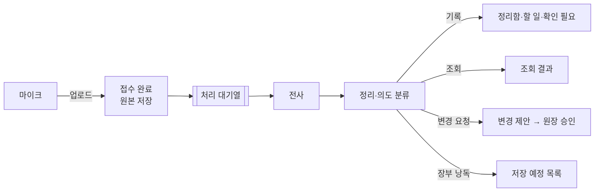

# 08. Phase 2 아키텍처 — 선택과 트레이드오프

> 대상: PM(카본)·개발팀 · 작성: 2026-11-16 · 상태: **제안(Proposed)** — 개발 리더(주드) 검토 후 개발-소셜 채널에서 논의
> 기준: 제품 백로그 v1.0(백로그 ID로 인용) + PM 회신(11/16: "편한 입력" 원칙, 필수 스키마는 PM이 별도 전달 예정) + PM 답변(PR #11·#12) + **Linear「MLP 범위·제품 결정」(PD-xx, 11/16) — 제품 결정이 다르면 이 문서가 우선**
> 기술 상세는 [02 아키텍처](02-architecture.md)·[ADR](../adr/)에 있다. 이 문서는 **"왜 이렇게 하는지"와 "무엇을 포기하는지"**만 다룬다.
> Phase 1도 함께 다룬다. Phase 2의 음성 조회·변경(P2-05·06)이 Phase 1의 녹음→전사→구조화 흐름을 그대로 쓰기 때문이다.

## 0. 한 장 요약

| # | 결정할 것 | 제안 | 한 줄 이유 (백로그 근거) | 포기하는 것 |
|---|---|---|---|---|
| A1 | 앱을 몇 개로 나누나 | **앱 1개(내부를 기능별로 분리) + 음성 처리 워커** | 웹·음성·전화가 같은 데이터·같은 예약 규칙을 써야 함 (원칙 3, 4.4) | 기능별 독립 배포·독립 확장 |
| A2 | 음성 처리를 언제 하나 | **업로드는 즉시 접수, 전사·정리는 뒤에서(비동기)** | 수신·전사·해석 단계를 구분하고 실패를 보여줘야 함 (P1-02·03) | 말하자마자 결과가 뜨는 즉시성 |
| A3 | DB | **PostgreSQL 1개** | 겹침 금지·매장 격리를 DB가 직접 보장 (P2-04, COM-01) | 스키마 없이 자유롭게 저장하는 유연함 |
| A4 | 이중 예약을 어떻게 막나 | **저장 전 검사 + DB 제약으로 최종 차단** (원장 강제 저장으로 최대 2건까지) | "저장 직전에도 충돌 확인" (P2-04, P3-07) | 충돌 시 예외 처리 코드가 늘어남 |
| A5 | AI가 데이터를 바꾸는 방법 | **AI는 제안만 → 원장 승인 → 웹과 같은 저장 경로** | 원장 확인 후 실행 (원칙 2, P2-06, P3-06·07) | 말 한 번으로 즉시 반영되는 편의 |
| A6 | 매장 데이터 분리 | **모든 데이터에 매장 표시 + DB가 다른 매장 접근 차단** | 다른 매장 기록 조회·변경 불가 (COM-01) | DB 설정·테스트가 조금 복잡해짐 |
| A7 | 입력을 얼마나 엄격하게 받나 | **기록은 무엇이든 저장, 예약 확정 때만 필수값 검사** | PM 제1원칙 "편한 입력" (11/16), 말로 남긴 예약을 즉시 확정하지 않음 (원칙 1) | 데이터가 처음엔 불완전함 → "확인 필요" 목록 관리 필요 |
| A8 | 수정을 어떻게 남기나 | **덮어쓰지 않고 수정 이력을 쌓음, 원본 음성·전사는 불변** | 수정 전후 구분, 원본 추적 (COM-02, P1-09) | 저장 공간·조회 쿼리가 조금 늘어남 |
| A9 | 채팅 질문에 어떻게 답하나 (MLP는 채팅만) | **정해진 조회 기능 목록 중에서 AI가 고르게 함** | 실제 저장된 데이터로만 답함 (P2-07, PD-04·05) | 목록에 없는 질문엔 답 못 함 → 목록을 늘려 가야 함 |
| A10 | 언어·프레임워크 | **TypeScript 하나로 통일 (권고, 미확정)** | 3~4명·8주, AI 외 난도는 낮다는 판단 (0절) | 파이썬 AI 라이브러리 생태계 |

---

## 1. 아키텍처를 정하게 만든 요구 (드라이버)

선택의 기준은 아래 여덟 가지다. 기술 취향이 아니라 백로그 문장에서 나왔다.

| 드라이버 | 백로그 근거 | 아키텍처에 주는 영향 |
|---|---|---|
| **같은 데이터, 같은 규칙** | 원칙 3, Phase 2 범위 경계, 4.4 "Phase별로 저장소를 새로 만들지 않음" | 저장소·예약 판단은 한 곳에만 둔다 |
| **AI는 원장 확인 후 실행** | 원칙 1·2, P2-06, P3-06·07 | AI와 DB 사이에 "제안 → 승인" 단계가 반드시 있다 |
| **실패·중복·정정도 기능** | 원칙 4, COM-03, P1-02, P2-06·09, P3-07 | 처리 단계별 상태 저장, 같은 요청 재전송은 한 번만 반영 |
| **동시에 겹친 예약은 확정 불가** | P2-04, P3-07 | 프로그램 검사만으로는 부족, DB가 마지막에 막아야 한다 |
| **매장 간 완전 분리** | COM-01 | 실수로 조건을 빠뜨려도 다른 매장 데이터가 안 보여야 한다 |
| **원문·출처·수정 이력** | COM-02, P1-09 | AI 결과마다 근거가 된 녹음·전사 위치를 남기고, 수정은 이력으로 |
| **편한 입력** | PM 회신 11/16, P1-04 "말하지 않은 필드는 채우지 않음" | 필수값을 최소화하고, 빈 값은 AI가 지어내지 말고 "확인 필요"로 |
| **빠른 개발** | 0절(빠른 출시·피드백), 8주, 개발 3명 | 운영할 서버·서비스 수를 최소로, 한 언어로 |

---

## 2. 결정별 트레이드오프

각 항목: 선택지 비교 → 제안 → 감수하는 것 → **나중에 바꾸기 어려운 정도** → 다시 볼 조건.

### A1. 앱 구조 — 하나의 앱(모듈형 모놀리스) + 음성 처리 워커

| 선택지 | 장점 | 단점 |
|---|---|---|
| **① 앱 1개, 내부를 기능 모듈로 분리** | 배포·운영할 것이 적다. 예약 규칙이 한 곳에만 있어 웹·음성·전화가 자동으로 같은 규칙을 쓴다. 3명이 이해하기 쉽다 | 한 모듈 장애가 전체에 영향. 모듈 경계를 규칙으로 지켜야 한다 |
| ② 기능별 서비스 분리(마이크로서비스) | 기능별 독립 배포·확장 | 3명·8주에 서버·통신·장애 지점이 몇 배. 예약 규칙이 여러 서비스에 흩어질 위험 |
| ③ Phase별 별도 앱 | Phase 1을 따로 빨리 만들 수 있다 | 백로그 4.4가 명시적으로 배제. 나중에 고객·기록을 합치는 비용이 큼 |

- **제안:** ①. 웹 API 서버와 음성 처리 워커는 같은 코드에서 실행 방식만 나눈다(배포 단위 2개 + 웹앱).
- **감수:** 사용자가 크게 늘면 일부를 떼어 내야 할 수 있다. 파일럿 규모에서는 문제 없다.
- **바꾸기 어려운 정도:** 낮음. 모듈 경계를 지켜 두면 필요할 때 떼어 낼 수 있다.

### A2. 음성 처리 흐름 — 즉시 접수, 뒤에서 처리

| 선택지 | 장점 | 단점 |
|---|---|---|
| **① 접수 후 비동기 처리(대기열)** | 업로드는 1초 내 "받았음" 응답 → 기기가 재전송·유실 판단을 빨리 함. 전사·AI가 실패해도 원본은 남고 재시도 가능. 단계별 상태(수신/전사/해석/실패)를 그대로 보여줄 수 있다 (P1-02·03) | 결과가 몇 초~수십 초 뒤에 뜬다. 화면에 "처리 중" 상태가 필요 |
| ② 업로드 요청 안에서 전사·AI까지 처리 | 구현이 단순, 결과 즉시 반환 | AI가 느리거나 실패하면 업로드 자체가 실패 → 녹음 유실·중복 재전송 위험 |

- **제안:** ①. 대기열은 처음엔 **PostgreSQL 안에** 둔다(서비스를 하나 덜 운영). 처리량이 커지면 전용 큐로 교체.
- **감수:** 음성 조회(P2-05)의 답이 바로 나오지 않는다. 백로그도 "초기 결과는 웹앱에서 확인"이라 맞다.
- **바꾸기 어려운 정도:** 낮음.

### A3. 데이터베이스 — PostgreSQL 1개

| 선택지 | 장점 | 단점 |
|---|---|---|
| **① PostgreSQL** | "시간 구간이 겹치면 저장 거부"를 DB 기능으로 바로 표현(A4). 매장별 접근 차단 기능 내장(A6). 고객·예약처럼 관계가 많은 데이터에 적합. AI 결과처럼 모양이 바뀌는 데이터도 JSON으로 함께 저장 | 스키마 변경 시 마이그레이션 관리 필요 |
| ② 문서형 DB(Firestore·MongoDB 등) | 스키마 없이 빠르게 시작 | 겹침 금지·매장 격리를 전부 앱 코드로 직접 해야 함 → 이중 예약 위험이 앱 코드 품질에 달림 |
| ③ SQLite | 설치가 가장 쉬움 | 여러 매장·동시 저장에 약함. 파일럿 확장 시 교체 필요 |

- **제안:** ①. 음성 파일은 DB가 아닌 파일 저장소(S3 호환)에 두고 DB에는 위치만 저장.
- **감수:** 스키마 설계를 먼저 해야 한다. PM이 필수 스키마를 보내 주시면 그 범위만 먼저 만든다(전 Phase 완성형 모델을 미리 만들지 않음, 4.4).
- **바꾸기 어려운 정도:** **높음.** 데이터가 쌓인 뒤 DB를 바꾸기는 어렵다. 그래서 지금 정하려는 것.

### A4. 이중 예약 방지 — 저장 전 검사 + DB 최종 차단

| 선택지 | 장점 | 단점 |
|---|---|---|
| ① 앱에서 겹침 검사 후 저장 | 구현 쉬움 | 두 요청이 거의 동시에 오면 둘 다 "비어 있음"으로 보고 둘 다 저장됨 (실제로 흔한 버그) |
| **② 앱 검사(친절한 안내) + DB 제약(최종 차단)** | 동시 요청이 와도 DB가 하나만 통과시킴. 웹·음성 승인·전화·장부 입력 어느 경로든 같은 보장 | 차단됐을 때 "방금 다른 예약이 들어왔어요"를 처리하는 코드가 필요 |
| ③ 모든 예약 저장을 한 줄로 세워 순서대로 처리 | 확실함 | 느리고 구조가 복잡, 1인 매장 규모에 과함 |

- **제안:** ②. 동시에 100번 저장해도 하나만 확정되는지 자동 테스트로 확인한다(스파이크 S4).
- **PM 결정 반영 (Linear「MLP 범위·제품 결정」PD-11~14·18):**
  - 같은 시간 겹치는 예약은 **매장당 최대 2건**. ("최대 3명"은 매장 3곳의 원장 3명이 동시에 쓴다는 뜻, PD-10)
  - 일반 저장은 겹치면 실패 → 화면에서 "시간 옮기기 / 강제 저장". **강제 저장해도 2건 초과·영업시간 밖은 불가.**
  - 겹침 판정은 **시술 시간만**. 준비·정리 시간(합쳐 기본 30분)은 넣지 않는다.
  - 원장이 만든 예약은 승인하면 바로 확정. "요청" 상태는 전화 접수처럼 원장이 아닌 경로에만.
  - 구현안: 예약마다 내부 "자리" 번호(1·2)를 두고 자리별로 DB가 겹침을 막는다 → 어느 순간에도 3건째는 DB가 거부. 자리는 일반/강제 저장과 상관없는 내부 번호이고, 강제 저장 여부는 따로 기록한다.
  - 저장 순서(매장 단위 잠금 안에서): 영업시간·임시 차단 검사 → 두 자리 전체에서 겹침 확인 → 일반 저장이면 겹칠 때 거절(옮기기/강제 저장 선택) → 강제 저장이면 겹치는 예약 묶음의 자리를 다시 배정해 2자리 안에 들어가면 저장, 아니면 거절. 상세와 반례는 [02 §3](02-architecture.md).
  - 강제 저장은 원장만 고를 수 있다(AI 제안은 불가).
- **감수:** 강제 저장 때 기존 예약의 내부 자리 번호가 바뀔 수 있어 저장 절차가 조금 복잡하다. 대신 DB가 "동시 3건"을 끝까지 막는다. 리뷰에서 나온 반례들을 S4 테스트로 고정한다.
- **바꾸기 어려운 정도:** 중간. 규칙이 바뀌면 제약만 교체.

### A5. AI가 데이터를 바꾸는 경로 — 제안 → 승인 → 같은 저장 경로

| 선택지 | 장점 | 단점 |
|---|---|---|
| ① AI가 직접 저장 기능을 호출 | 빠르고 편함 | 잘못 알아들은 지시가 바로 반영됨. 원칙 2 위반 |
| **② AI는 "변경 제안"만 만들고, 원장이 웹에서 승인하면 실행** | 원장이 변경 전후를 보고 결정. 승인된 것만 웹 수정과 **같은 저장 경로**로 실행 → 예약 규칙 하나. P2-06·P2-09·P3-06·07이 같은 구조를 재사용 | 원장이 승인하는 단계가 하나 늘어남 |
| ③ AI가 반영 후 원장이 되돌리기 | 빠름 | 되돌리기 전까지 틀린 예약이 존재. 고객 발송(3B)과 엮이면 되돌릴 수 없음 |

- **제안:** ②. 승인은 말("네", "좋아")이 아니라 **웹앱의 버튼**으로만 받는다(말을 AI가 승인으로 오해하는 것 방지). 조회와 기록 정리는 승인 없이 자동(원칙 2).
- **PM 결정 반영(PD-29·32):** 마이크에서 온 변경안과 **채팅에서 만든 변경안을 같은 승인 화면**에서 승인한다. 승인 화면은 하나만 만든다.
- **PM 답변 반영(Q17):** 일괄 승인 허용, 미승인 제안 **48시간 후 자동 만료**. 승인 화면은 한 건씩 크게 보여주고 버튼 2개로 시작(스와이프는 이후).
- **감수:** 승인 부담. 일괄 승인·자동 만료로 완화한다.
- **바꾸기 어려운 정도:** 중간. 나중에 조건부 자동 처리(P3-10)를 넣어도 이 구조 위에 "자동 승인 규칙"을 얹으면 된다.

### A6. 매장 데이터 분리 — DB가 직접 차단

| 선택지 | 장점 | 단점 |
|---|---|---|
| ① 앱 코드의 모든 조회에 "이 매장만" 조건을 붙임 | 단순 | 한 곳만 빠뜨려도 다른 매장 데이터 노출. AI가 생성한 코드에서 특히 놓치기 쉬움 |
| **② ① + DB가 현재 매장 외 데이터를 아예 돌려주지 않게 설정(행 단위 보안)** | 코드 실수가 있어도 DB에서 막힘 | 설정·테스트가 조금 복잡. 관리자용 전체 조회는 별도 경로 필요 |
| ③ 매장마다 DB를 따로 | 분리가 확실 | 매장이 늘수록 운영·마이그레이션 비용 급증 |

- **제안:** ②. 고객 연락처·음성 같은 개인정보를 다루므로 "실수해도 안전한" 쪽을 고른다.
- **바꾸기 어려운 정도:** 중간. 처음부터 넣는 것이 나중에 넣는 것보다 훨씬 싸다.

### A7. 입력 엄격도 — "편한 입력"을 구조로 반영

PM 원칙(11/16): 이름이나 시간 하나만으로도 일단 기록하고, 나중에 확인한다.

| 선택지 | 장점 | 단점 |
|---|---|---|
| ① 저장할 때 필수값을 모두 요구 | 데이터가 깔끔 | 편한 입력 원칙과 충돌. 말로 남긴 기록이 저장 실패 |
| **② 단계마다 요구하는 값을 다르게** | 기록은 무엇이든 저장, 확정 단계에서만 검사. 편한 입력과 이중 예약 방지를 동시에 만족 | "확인 필요" 목록 화면과 상태 관리가 필요 |

단계별로 요구하는 값 (예시, PM 필수 스키마 받은 뒤 확정):

| 단계 | 최소 요구 | 빠진 값 처리 |
|---|---|---|
| 기록(메모) | 녹음 하나 | 고객·날짜를 못 찾으면 "확인 필요"로 표시 (P1-05) |
| 고객 | 이름 또는 원장이 부른 호칭 | 전화번호 등은 나중에. 이름만으로 기존 고객과 자동 합치지 않음 (P2-02) |
| 예약 요청 | 고객 후보 또는 시간 중 하나 | 확정 전까지 캘린더에 "요청"으로만 표시 |
| **확정 예약** | 고객 + 시작 시각 + 소요 시간 | 이 단계에서만 충돌 검사(A4). 빠지면 확정 불가, 원장에게 질문 |

- **제안:** ②. AI는 말하지 않은 값을 지어내지 않고 빈칸으로 둔다(P1-04). 이 빈칸이 곧 "확인 필요" 목록이 된다.
- PM 답변 반영(Q8·Q19): 고객은 **이름만 필수**, 전화번호는 권장(없어도 생성 가능).
- ASSUMPTION: "확정 예약"의 최소 요구값은 PM 필수 스키마 확정 후 조정.
- **바꾸기 어려운 정도:** 중간. 필수값을 나중에 **완화**하기는 쉽지만, 불완전 데이터가 쌓인 뒤 **강화**하기는 어렵다.

### A8. 수정 이력 — 덮어쓰지 않고 쌓기

| 선택지 | 장점 | 단점 |
|---|---|---|
| ① 수정 시 기존 값 덮어쓰기 | 단순 | 무엇이 언제 왜 바뀌었는지 사라짐. 인사이트의 변경 추이(P2-11 확장)를 나중에 만들 수 없음 |
| **② 원본은 불변, 수정은 이력으로 추가, 최신본을 계산** | 수정 전후 구분·원본 추적(COM-02, P1-09). AI 재처리 시 최신 정정본 사용 | 데이터·조회가 조금 늘어남 |

- **제안:** ②. 예약 변경도 처음부터 이력을 남긴다 — 나중에 소급할 수 없다.
- **바꾸기 어려운 정도:** **높음**(지나간 이력은 복구 불가).

### A9. 질문 처리 — 정해진 조회 기능 중 선택 (MLP는 채팅만)

| 선택지 | 장점 | 단점 |
|---|---|---|
| ① AI가 DB 조회문(SQL)을 직접 작성 | 어떤 질문이든 시도 가능 | 틀린 조회·다른 매장 접근·데이터 변경 위험. 결과 검증 어려움 |
| **② "고객 찾기·특정일 예약·빈 시간…" 같은 조회 기능 목록을 만들고 AI는 고르기만** | 답이 항상 실제 데이터에 근거하고 근거 기록을 함께 보여줄 수 있음(P2-07). 나중에 음성 조회(P2-05)를 열면 같은 목록 재사용 | 목록에 없는 질문엔 "지원하지 않는 질문"으로 답 → 목록을 늘려 가야 함 |
| ③ 문서 검색형(RAG) | 자유 메모 검색에 강함 | 예약 수·빈 시간처럼 정확한 숫자 질문에 약함 |

- **제안:** ②로 시작. 자유 메모 검색이 필요해지면 ③을 조회 기능 하나로 추가.
- **PM 결정 반영(PD-04·05·40·42):** MLP에서 **마이크는 기록·변경 전용**, 조회는 채팅에서만 한다(음성 조회 P2-05는 MLP 제외). 마이크·채팅 통합 질의 엔진은 MLP 필수가 아니다. 1차 조회 4종: 이름으로 고객 찾기 / 특정일 예약 수 / 빈 시간 / 다음 예약. 채팅 대화는 90일 보관, 숨기기는 삭제가 아님.
- **필요한 PM 입력:** 질문 목록과 질문별 기대 답변(상세 기능 명세서, BEA-83).

### A10. 언어·프레임워크 — TypeScript 단일 (✅ 11/17 확정, ADR-0006)

| 선택지 | 장점 | 단점 |
|---|---|---|
| **① TypeScript로 웹·서버·워커 통일** | 한 언어로 3명이 서로의 코드를 리뷰. API 계약 타입을 웹·서버가 공유. AI 코딩 도구의 생성 품질이 높음 | 음성 신호 처리 라이브러리는 파이썬보다 약함 (단, STT·LLM은 외부 API라 영향 작음) |
| ② 웹 TypeScript + 서버 Python | AI·오디오 생태계 풍부 | 언어 2개, 계약 타입 별도 생성 |
| ③ 관리형 백엔드(Supabase 등) 중심 | 인증·DB·파일 저장 즉시 사용, 초기 속도 최고 | 특정 업체 종속, 국내 리전·개인정보 검토 필요, 음성 처리 워커는 어차피 별도 |

- **결정 ✅ (11/17):** ①. PM 결정이 아니라 **개발팀 결정**으로 확정했다(ADR-0006 Accepted). 구체안(웹 React+Vite, 서버 NestJS, 비슷한 CRM 서비스 사례)은 [ADR-0006](../adr/0006-tech-stack-ts-monorepo.md).
- **바꾸기 어려운 정도:** 높음(코드가 쌓인 뒤).

### 함께 정할 것 (짧게)

| 항목 | 제안 | 의존 |
|---|---|---|
| 원장 화면 | 스마트폰 우선 반응형 웹(홈 화면 추가) + 매장 노트북에서도 사용. 네이티브 앱은 백로그상 초기 제외 | ✅ Q2: 스마트폰·노트북, 모바일 최적화 필수 |
| 호스팅 | 저장은 국내 리전 우선, AI 처리는 해외 서비스 사용 가능. 원본 음성 기본 30일 보관 후 삭제, 전사문·정정 이력은 유지(PD-61) | ✅ Q9 / 클라우드 계정 명의(Q13, 리더 명의 건의) |
| STT·LLM 업체 | 교체 가능하게 감싸 두고 실제 샘플로 비교 후 선택(S1·S2) | 원장 실제 발화 샘플 |

---

## 3. 안전성 관점 — 무엇이 잘못될 수 있고, 무엇이 막는가

PM 회신에 "안전성 문제"가 언급되어, 위험별로 어떤 선택이 막는지 정리했다. 다른 관점의 우려였다면 알려 주시면 이 표에 추가한다.

| 잘못될 수 있는 일 | 막는 장치 | 관련 결정 |
|---|---|---|
| 같은 시간에 예약이 너무 많이 확정됨 | DB 제약 + 동시 저장 테스트. 일반 1건, 원장이 명시적으로 강제 저장해야 2건, 3건째는 DB가 거부 | A4 |
| AI가 잘못 알아듣고 예약·고객을 바꿈 | 제안 → 버튼 승인 → 실행 | A5 |
| AI가 말하지 않은 전화번호·시간을 지어냄 | 근거 없는 값은 버리고 "확인 필요" | A7 |
| 다른 매장 고객 정보가 보임 | DB 행 단위 보안 | A6 |
| 재전송·버튼 두 번 클릭으로 같은 예약이 두 번 생김 | 요청마다 고유 키, 같은 키는 한 번만 반영 | A2·A5 |
| 업로드·AI 실패로 녹음이 사라짐 | 원본 먼저 저장, 처리 단계별 상태·재시도 | A2 |
| 수정하다 원래 내용을 잃음 | 원본 불변 + 수정 이력 | A8 |
| AI 대화로 매장 설정이 몰래 바뀜 | 설정은 웹 화면에서만 변경 | A5 |

---

## 4. 이 구조가 감수하는 비용 (솔직하게)

- **즉시성 부족:** 음성 → 결과까지 수 초~수십 초. 화면에 처리 단계 표시가 필수.
- **승인 부담:** 변경마다 원장 탭이 필요. 일괄 승인·자동 만료(Q17)로 완화 예정.
- **"확인 필요" 관리:** 편한 입력의 대가로 불완전 기록이 쌓인다. 정리함에서 빠르게 처리하는 UX가 핵심.
- **초기 설계 비용:** DB 제약·행 단위 보안·이력 구조는 처음에 시간이 더 든다. 대신 나중에 넣는 비용(데이터 정리·소급 불가)보다 훨씬 싸다.

## 5. PM 확인 필요

| 항목 | 영향받는 결정 |
|---|---|
| 필수 스키마(전달 예정) — 특히 **"확정 예약"에 꼭 필요한 값** | A3·A7 |
| 언급하신 **안전성 우려의 구체적 내용** | §3 |
| 지원할 질문 목록 — Q11(상세 기능 명세서로 전달 예정), Q21 4종은 1차 목록으로 확정 | A9 |
| 월 운영 예산 상한 — Q13 → 11/17 회의: AI API는 지원금 27만 원 한도 PM 부담, 클라우드는 팀 균등 분담·무료 티어 우선. 호스팅 AWS EC2 + RDS([ADR-0007](../adr/0007-hosting-aws-ec2-rds.md)) | 호스팅·AI 업체 선택 |

✅ 반영 완료: Q2(화면), Q6·Q18(운영 규칙·강제 저장 최대 2건), Q8·Q19(고객 필수값), Q9(해외 AI·보관), Q17(일괄 승인·48시간 만료), Linear PD 결정(마이크 조회 제외, 공용 승인 화면, 채팅 90일 보관).

11/17 회의에서 정할 것(Linear 총정리 M1~M5): Phase 1·2 병렬 여부, 월 예산 상한, 클라우드 계정 명의, 토큰 노출 한계, Linear 백로그를 GitHub 이슈로도 만들지.
